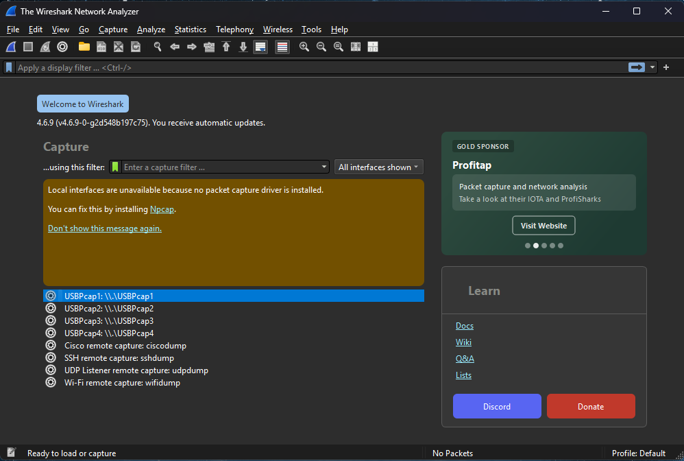
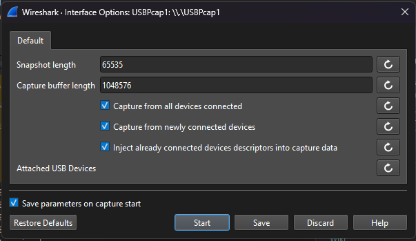
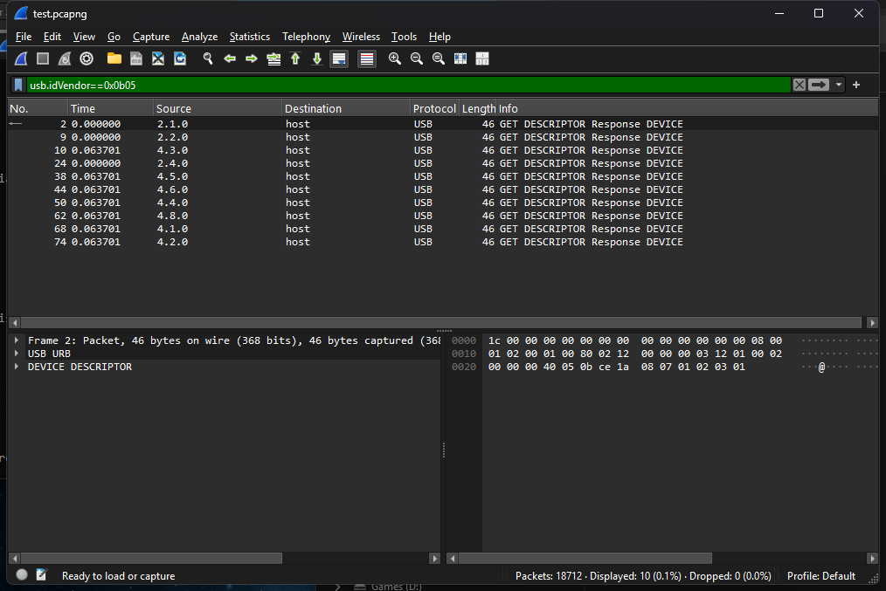

# Help add support for your device: record its USB traffic

RIGStats drives lighting, mice, keyboards and headsets by sending them the same
messages their maker's own software sends. Many makers don't publish those
messages. When nobody has documented them for your device, a short recording of
what the maker's software sends is often the missing piece.

This page shows how to make that recording. It takes about 20 minutes plus one
restart, and you don't need to know anything about USB.

**Your device is never at risk.** Nothing from RIGStats is sent to it while you
record: you only listen to what the maker's software sends. RIGStats itself
only ever sends a device messages its maker's software was seen sending, or
that are publicly documented, never guesses.

## What you need

- The **maker's software** for the device (for example MSI Center, Armoury
  Crate, Razer Synapse, Logitech G HUB), working with your device.
- **Wireshark**, free: <https://www.wireshark.org/download.html>, the Windows
  x64 installer.
- **USBPcap**, which lets Wireshark see USB:
  <https://github.com/desowin/usbpcap/releases>. Get the newest
  `USBPcapSetup-….exe`.
- Your device's **vendor id**, a four-digit hex number such as `0DB0`. See
  [Find your device's vendor id](#find-your-devices-vendor-id) below, or ask us
  in your issue; we'll tell you.

## Find your device's vendor id

Every USB device reports two four-digit hex numbers: a **vendor id** (who made
the chip it uses) and a **product id** (which model). The vendor id is what the
filter in step 4 needs.

**On your own PC (most reliable):**

1. Right-click Start → **Device Manager**.
2. Open **Human Interface Devices** (or **Keyboards**, **Mice and other pointing
   devices**, **Sound, video and game controllers**) and double-click your
   device. Many entries are called *USB Input Device* or *HID-compliant
   device*; try the ones that appear and disappear when you unplug it.
3. **Details** tab → *Property* → **Hardware Ids**. A line starting with
   `HID\VID_0DB0&PID_0076` means vendor id **`0DB0`** and product id `0076`
   (what follows, such as `&MI_02`, doesn't matter here).

**Or from RIGStats:** **Status → Collect diagnostics**, then in the ZIP open
`lighting-devices.json`. Under `hid_scan`, every USB device is listed with its
`vendor_id`, `product_id` and name.

**Common brands**, from the public [USB ID list](http://www.linux-usb.org/usb.ids)
(version 2026.06.26). Search this page with Ctrl+F:

| Brand | Vendor id |
|---|---|
| ASUS / ROG | `0B05` |
| Corsair | `1B1C` |
| Creative | `041E` |
| Gigabyte | `0414` |
| HP (also newer HyperX) | `03F0` |
| Kingston (older HyperX) | `0951` |
| Logitech | `046D` |
| Mad Catz | `0738` |
| MSI | `0DB0`, `1462` |
| NZXT | `1E71` |
| Razer | `1532` |
| Roccat | `1E7D` |
| Sennheiser | `1377` |
| SteelSeries | `1038` |
| Thermaltake | `264A` |
| Turtle Beach | `10F5` |
| Cooler Master | `2516` |
| ASRock | `1849` |
| Elgato | `0FD9` |
| Sharkoon | `1EA7` |

**A device can use its chip maker's id instead of its brand's.** For example:
- RGB controllers built on ITE chips report `048D` (ITE). Many motherboards' RGB controllers are these.
- Many keyboards report `04D9` (Holtek) or `0C45` (SONiX / Microdia).

Your own PC (above) always shows the real one. To look an id up, search
[DeviceHunt](https://devicehunt.com/) or the [USB ID list](http://www.linux-usb.org/usb.ids).

## 1. Install

1. Install **Wireshark**.
2. Install **USBPcap** with its default options, **after** Wireshark.
3. **Restart Windows.** USBPcap only works after a restart.

## 2. Prepare

1. Quit RIGStats from its tray icon (right-click → **Quit**), so only the
   maker's software talks to the device.
2. Start **Wireshark as administrator**: right-click its icon → *Run as
   administrator*.
3. The start screen lists interfaces called **USBPcap1**, **USBPcap2**, … (one
   per USB controller). If they're not there, USBPcap isn't working yet. Restart
   Windows, or tell us in your issue.

   A yellow box saying local interfaces need **Npcap** may show too. That's
   about network capture, not USB, so **ignore it**.

   

4. Click the small **gear** next to **USBPcap1** and check that these three are
   ticked. They are by default:
   - *Capture from all devices connected*
   - *Capture from newly connected devices*
   - *Inject already connected devices descriptors into capture data*

   Close it with **Discard**.

   

> ⚠️ **While recording, don't type anything. Use only the mouse.** The
> recording includes every USB device, so it would also contain the keys you
> press: no passwords, no chat while it runs.

## 3. Record

1. Select all **USBPcap** interfaces (Ctrl+click each one) and press the blue
   **shark fin** button (top left) to start recording.
2. Open the maker's software. Make one change at a time, **wait 5 seconds**
   after each, and **write down the time** of each (the taskbar clock is fine).
   For lighting, for example:
   1. Static, **red**
   2. Static, **green**
   3. Static, **blue**
   4. A **built-in effect** (breathing, wave, …)
   5. Lighting **off**
   6. Back to what you normally use

   For a mouse, keyboard or headset, change one setting at a time instead (a
   DPI level, the polling rate, sidetone, …), and tell us what you changed.

   We'll name in your issue exactly which changes we need, when there is
   something specific.
3. **Close the maker's software completely**: close the window, then
   right-click its tray icon → *Exit*, if it has one. Wait **10 seconds**. This
   shows how the software hands the device back, which RIGStats needs to do too
   when it stops.
4. Press the red **square** to stop recording.

## 4. Check

Type `usb.idVendor == 0x` followed by your device's vendor id (for example
`usb.idVendor == 0x0db0` for an MSI Mystic Light board) in the filter bar at the
top and press Enter.

At least one line should appear: that's your device announcing itself. If
nothing appears, tell us; the recording may have missed the controller it sits
on.

## 5. Save and send

1. **File → Save As…**, keep the format *pcapng*. It goes to your
   **Documents** folder unless you pick another.
2. Zip it: right-click the file → *Send to → Compressed (zipped) folder*. A
   minute is about 1–2 MB.
3. Attach the ZIP to your issue on GitHub, with:
   - the times you wrote down and what you did at each;
   - the device's name and model, and the maker's software and its version;
   - what the device did after you closed the maker's software (kept its
     effect, froze, changed, went off).

Attachments on GitHub are public. Because you didn't type during the recording,
it holds only the USB traffic of those minutes: no files, passwords or other
personal data.

## What happens next

We read the recording with Wireshark's command-line tool (`tshark`), keep only
your device's traffic, and match each message to the change you made at that
time. When the messages make sense, we build the support. It's marked **not yet
verified** until you, or someone else with the device, confirms it works.

Thank you for helping. Every recording makes RIGStats work for more people.
